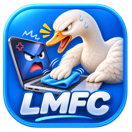
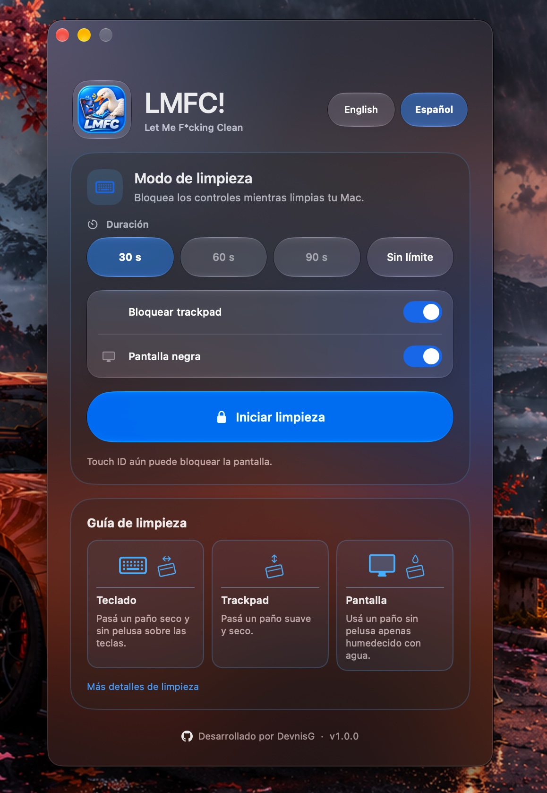
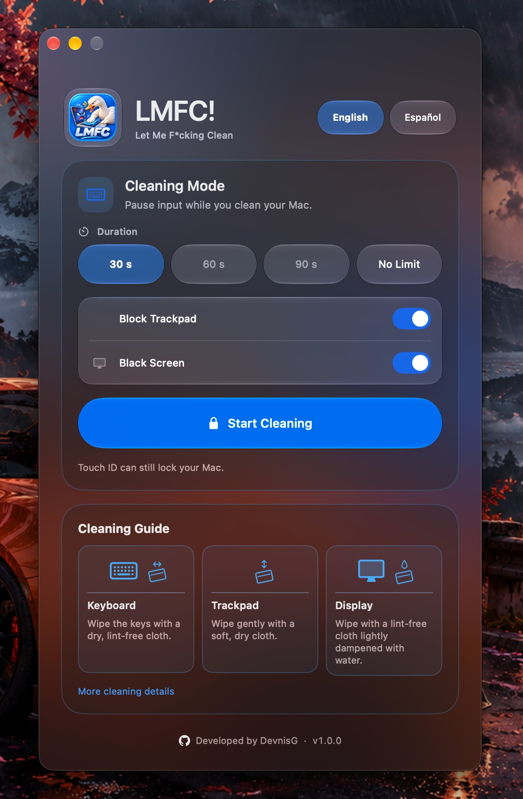

# LMFC!



**Limpiá tu MacBook sin pulsaciones accidentales.** LMFC! (Let Me F\*cking Clean) bloquea el teclado y el trackpad mientras limpiás. Pone la pantalla en negro para que veas mejor el polvo y las marcas.

**v1.0.0 · Apple Silicon · macOS 15 o posterior**

[English](#english)

## Funciones

- Bloqueá el teclado, incluidas las teclas multimedia compatibles.
- Bloqueá el movimiento, los clics y el desplazamiento del trackpad y el mouse.
- Poné las pantallas en negro con un contador en el centro para ver el polvo y las marcas.
- Elegí 30, 60 o 90 segundos, o usá el modo **Sin límite**.
- Consultá la guía ilustrada para limpiar el teclado, el trackpad y la pantalla.
- Cambiá entre español e inglés desde la ventana principal.

## Requisitos

- Mac con Apple Silicon y macOS 15 Sequoia o posterior.
- Permiso de **Accesibilidad** y, si macOS lo solicita, **Monitorización de entrada**.
- Xcode 26 o posterior para compilar el proyecto.

## Instalación

Descargá el DMG de la [versión v1.0.0](https://github.com/DevnisG/LMFC/releases/tag/v1.0.0) y arrastrá **LMFC.app** a **Aplicaciones**.

También podés instalar LMFC! con Homebrew.

```sh
brew tap devnisg/lmfc https://github.com/DevnisG/LMFC.git
brew install --cask devnisg/lmfc/lmfc
```

El DMG y la app usan firma ad hoc. Si macOS bloquea la primera apertura, revisá el aviso en **Configuración del Sistema → Privacidad y seguridad** antes de elegir **Abrir igualmente**. Tras una actualización, macOS puede volver a pedir los permisos de entrada.

## Cómo usar LMFC!

1. Abrí LMFC! y concedé los permisos que indique la app. **Mostrar en Finder** y **Copiar ruta** te ayudan a seleccionar la copia correcta.
2. Elegí la duración. **Bloquear trackpad** y **Pantalla negra** vienen activados. Con el trackpad bloqueado, las sesiones con temporizador duran 30 segundos.
3. Pulsá **Iniciar limpieza**. Si la app te pide una tecla de prueba, presioná una letra para verificar el bloqueo.
4. Para una sesión con temporizador, esperá a que termine o pulsá **Terminar limpieza** cuando tengas el puntero disponible. **⌘⌥⇧U** recupera el trackpad y las pantallas durante la sesión. En modo **Sin límite**, el mismo atajo termina la sesión completa.

macOS controla Touch ID y el botón de encendido.

## Privacidad

LMFC! procesa los eventos de entrada en memoria durante la sesión y guarda la preferencia de idioma en macOS.

## Compilar desde el código fuente

Abrí `LMFC.xcodeproj` en Xcode y ejecutá el esquema `LMFC` en **My Mac**. También podés compilar desde la raíz del repositorio con firma ad hoc.

```sh
xcodebuild -project LMFC.xcodeproj \
  -scheme LMFC \
  -destination 'platform=macOS,arch=arm64' \
  -derivedDataPath .build \
  ARCHS=arm64 CODE_SIGN_IDENTITY=- DEVELOPMENT_TEAM= build
```

## Licencia y autoría

Distribuido bajo la licencia MIT. Copyright © 2026 DevnisG. [Licencia](LICENSE) · [GitHub](https://github.com/DevnisG) · [Licencias de terceros](LMFC/Resources/ThirdPartyNotices.txt)

---

## English

**Clean your MacBook without accidental input.** LMFC! (Let Me F\*cking Clean) blocks the keyboard and trackpad while you clean. It blacks out the screen to make dust and smudges easier to see.

**v1.0.0 · Apple Silicon · macOS 15 or later**

[Español](#lmfc)

### Features

- Block the keyboard, including supported media keys.
- Block movement, clicks, and scrolling from the trackpad and mouse.
- Black out your displays with a centered countdown to make dust and smudges easier to see.
- Choose 30, 60, or 90 seconds, or use **No Limit**.
- Follow the illustrated guide for cleaning your keyboard, trackpad, and display.
- Switch between English and Spanish from the main window.

### Requirements

- Apple Silicon Mac with macOS 15 Sequoia or later.
- **Accessibility** permission and **Input Monitoring** if macOS requests it.
- Xcode 26 or later to build the project.

### Installation

Download the [v1.0.0 DMG](https://github.com/DevnisG/LMFC/releases/tag/v1.0.0) and drag **LMFC.app** into **Applications**.

You can also install LMFC! with Homebrew.

```sh
brew tap devnisg/lmfc https://github.com/DevnisG/LMFC.git
brew install --cask devnisg/lmfc/lmfc
```

The DMG and app use ad hoc signatures. If macOS blocks the first launch, review the warning in **System Settings → Privacy & Security** before choosing **Open Anyway**. macOS may ask for input permissions again after an update.

### How to use LMFC!

1. Open LMFC! and grant the permissions shown in the app. **Show LMFC in Finder** and **Copy App Path** help you select the right copy.
2. Choose a duration. **Block Trackpad** and **Black Screen** are enabled by default. Timed sessions run for 30 seconds when trackpad blocking is on.
3. Click **Start Cleaning**. If prompted, press a letter key to verify the filter.
4. For a timed session, wait for it to finish or click **Stop Cleaning** when the pointer is available. **⌘⌥⇧U** restores the trackpad and displays during a session. In **No Limit** mode, the same shortcut ends the entire session.

macOS controls Touch ID and the power button.

### Privacy

LMFC! processes input events in memory during the session and saves the language preference in macOS.

### Build from source

Open `LMFC.xcodeproj` in Xcode and run the `LMFC` scheme on **My Mac**, or use the [build command above](#compilar-desde-el-código-fuente).

### License and author

Released under the MIT License. Copyright © 2026 DevnisG. [License](LICENSE) · [GitHub](https://github.com/DevnisG) · [Third-party notices](LMFC/Resources/ThirdPartyNotices.txt)

---

## Capturas / Screenshots

### LMFC! en español



### LMFC! in English


